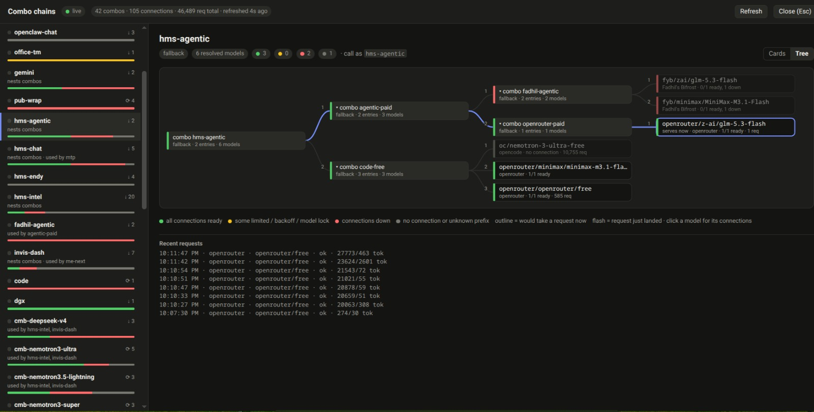

# 9router Combo Visualizer

A userscript that shows your [9router](https://github.com/decolua/9router) **combo chains** as a
live overlay on the 9router dashboard.

9router combos can nest other combos, mix fallback with round-robin, and point at dozens of
provider connections that drift in and out of rate limits. The dashboard lists the entries; this
overlay shows how a request actually travels through them.



## What it shows

- **The chain of every combo:** fallback entries in try order, round-robin / random / smart /
  fusion entries as a parallel group, nested combos expanded inline (with cycle detection).
- **Three views:** *Cards* (nested boxes, good for reading details), *Tree* (a left-to-right
  diagram of combo → entries → nested combos → models → connections, with fallback branches
  numbered and the path to the serving entry highlighted) and *Flow* (the same diagram, but each
  model appears once in a last column grouped by provider, so every route that reaches it
  converges on one node; numbered edges keep the fallback order, and clicking a combo highlights
  everything it can reach).
- **Provider health per model:** each entry is resolved to its provider (custom node prefix,
  built-in alias, or provider id) and coloured by its connections:
  🟢 all ready · 🟡 some rate-limited, backing off or model-locked · 🔴 down or disabled ·
  ⚪ no connection / unknown prefix.
- **What would serve now:** the entry that a request would land on given current health
  (outlined), or every candidate for non-fallback strategies.
- **Connection details:** click a model to see its connections in priority order with the
  reason each is unavailable and when it was last used.
- **Live traffic:** request counts and last-used time per model, a pulse while a request is in
  flight, a flash when one completes, and a recent-requests feed, all from the dashboard's own
  usage stream.
- **Cross-references:** which combos nest a combo ("used by"), plus a filter over combo and model
  names.

## Install

1. Install [Tampermonkey](https://www.tampermonkey.net/) or
   [Violentmonkey](https://violentmonkey.github.io/) in your browser.
2. Open
   **[dist/9router-combo-visualizer.user.js](https://raw.githubusercontent.com/alfiyansys/9router-combo-visualizer/main/dist/9router-combo-visualizer.user.js)**
   and click **Install**.
3. Open your 9router dashboard and log in. A **⛓ Chains** button appears at the bottom right.

Updates arrive automatically through the userscript manager.

## Use

| Action | How |
|---|---|
| Open / close the overlay | **⛓ Chains** button, `Alt+Shift+C`, or the userscript menu |
| Close | `Esc` or **Close** |
| Pick a combo | click it in the sidebar, or a "used by" link |
| Switch between cards and tree | **Cards / Tree** toggle (remembered per browser) |
| Collapse a nested combo | click its `▾ combo …` header or tree node |
| See a model's connections | click the model row or tree node |
| Hide the floating button | userscript menu → *Hide floating button* (the shortcut keeps working) |

The data refreshes every 15 s; traffic updates live.

## How it finds your dashboard

Nothing about your host is hardcoded, so it works on `localhost`, a LAN name, an IP or a public
domain alike. On every page the script:

1. stops right away unless the page title mentions *9router* or you allowlisted the origin;
2. calls `GET /api/combos` on the same origin and activates only if the answer looks like
   9router's. On the login page it waits and retries until you are signed in.

If you serve the dashboard under a custom title, use the userscript menu →
*Always check &lt;origin&gt;*. Use *Disable on &lt;origin&gt;* to switch it off for a site.

## Privacy and safety

- Runs entirely in your browser, inside the dashboard's origin, with your existing session.
- Read-only: it issues `GET` requests to the dashboard's `/api/*` endpoints and listens to
  `/api/usage/stream`. It never changes settings, tests providers or sends requests elsewhere.
- Never displays API keys or provider credentials.
- Plain, dependency-free JavaScript: read [`dist/9router-combo-visualizer.user.js`](dist/9router-combo-visualizer.user.js)
  before installing.

## Compatibility

Built and tested against **9router v0.5.109**. The overlay relies on the dashboard API listed in
[AGENTS.md](AGENTS.md#9router-api-contract); if a newer 9router changes it, please open an issue.

## Limitations

- Traffic is attributed per model and provider, not per combo, because the usage stream does not
  say which combo a request came through.
- "Serves now" is a prediction from connection health. Sticky round-robin state and smart/fusion
  scoring are not exposed by the API.
- Built-in provider aliases (e.g. `oc` → `opencode`) come from a snapshot of 9router's catalog,
  so aliases added in newer versions show as *unknown prefix* until the snapshot is refreshed.

## Development

No dependencies; Node ≥ 18 only for the build.

```sh
npm run build   # src/ -> dist/9router-combo-visualizer.user.js
npm run check   # syntax check + fail if dist/ is stale
```

See [AGENTS.md](AGENTS.md) for the layout, conventions, testing against a live dashboard and the
release steps.

## Upstream

This is an independent, unofficial add-on for [9router](https://github.com/decolua/9router) by
decolua. All credit for the router itself goes there.

To the 9router maintainers: if a chain view like this belongs in the dashboard, feel free to take
it. The code is MIT and dependency-free, and the chain resolution in [`src/core.js`](src/core.js)
does not depend on the userscript shell.

## License

[MIT](LICENSE)
